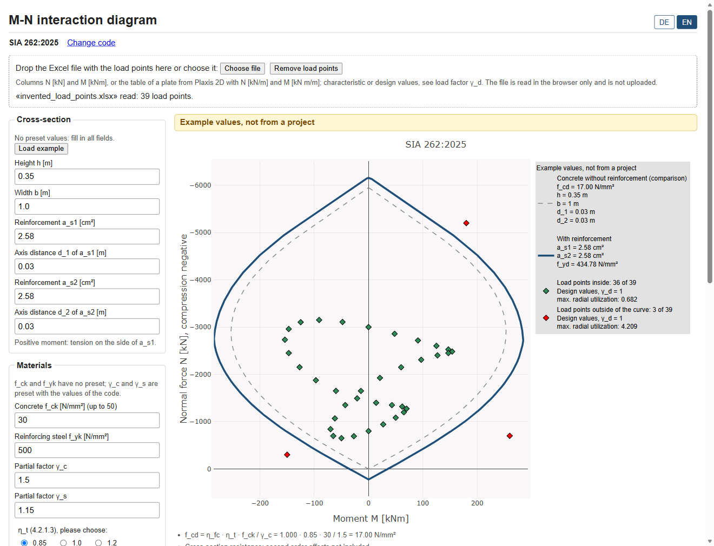
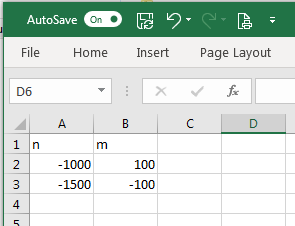
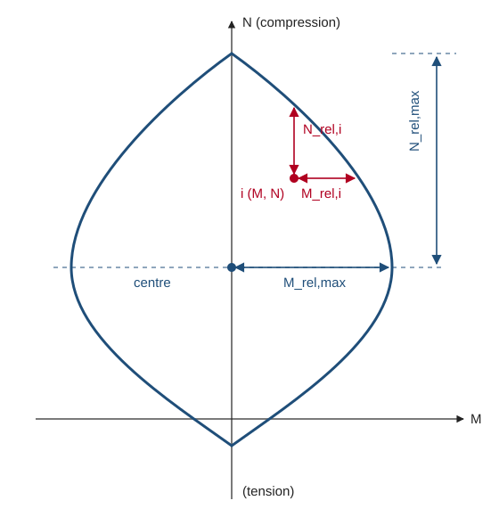

# M-N interaction diagram for reinforced concrete sections

Interaction diagram (bending moment M and normal force N) for rectangular
reinforced concrete cross-sections, with the index CULT-I for tunnel
linings. Everything is calculated in the browser; the load file is not
uploaded.

**Open the app: <https://interaction-diagram.onurkoc.net/>**

Validation status: the curve with reinforcement was compared with commercial program
for SIA 262 and symmetric reinforcement only. Everything else is only
covered by automated tests, not compared with an independent program
(details below).



The picture shows the example values of the app with invented load
points, not a project.

Two design codes can be chosen:

- **SIA 262:2025**
- **EN 1992-1-1** without National Annex (recommended values), minimum
  eccentricity e0 = max(h/30; 20 mm) selectable (6.1 (4))

The interface is in German and English (switch DE | EN at the top right).
A new visitor gets German if the browser is set to German, otherwise
English; the choice is kept in the browser. The input stays when the
language is changed.

## Scope and limits

The app checks a **cross-section** of a shotcrete lining for M and N.

- Rectangular section with two layers of reinforcement, or plain concrete.
- Concrete up to f_ck = 50 N/mm² (C50/60).
- **Not** for compression members with second order effects.
- No shear, no serviceability, no fire.

It is a tool for engineers. The assumptions and simplifications are listed
in [NOTES.md](NOTES.md) (in German), with the clause numbers of the codes.
The most important ones:

- Concrete: parabola-rectangle diagram with 2 ‰ and 3,5 ‰, no tensile
  strength. In the SIA mode this is equation (27) of SIA 262 with
  k_σ = 2, a deliberate simplification.
- Reinforcing steel: horizontal top branch (ideally plastic),
  E_s = 200 GPa. Neither code requires a strain limit for this branch
  (EN 1992-1-1 3.2.7 (2) b; SIA 262 4.2.2.5, 4.2.2.6). Assumption of this
  app: steel strain limited to 12 ‰.
- Strain planes with the pivot points A, B and C (EN 1992-1-1 6.1 (5),
  Figure 6.1). SIA 262 does not regulate pivot C; the app uses it there as
  a conservative assumption.
- Plain concrete (a_s1 = a_s2 = 0): reduced design strength, see NOTES.md.

**Validation status.** The curve with reinforcement was compared with
commercial program for one section, for SIA 262 and symmetric reinforcement only (see
NOTES.md section 6). EN 1992-1-1, asymmetric reinforcement, plain
concrete, the radial utilization and CULT-I are only covered by
automated tests, not compared with an independent program. The app shows
this note on its first page and below the calculator.

## How to use it

0. Open the app at <https://interaction-diagram.onurkoc.net/>. Locally:
   double-click `start.cmd` (Windows, needs Python 3) or run
   `npx http-server app -c-1`, see
   [Running it locally](#running-it-locally).
1. Choose the code on the first page. It can be changed at any time; the
   input is kept where it is valid for both codes.
2. Enter the cross-section and the materials. These fields have no preset
   values. An empty or invalid field gives a message and no result;
   nothing is corrected silently.

   | Input | Unit | Note |
   |---|---|---|
   | h, b | m | height and width |
   | a_s1, a_s2 | cm² | the two layers of reinforcement |
   | d_1, d_2 | m | distance of the axis of a_s1 / a_s2 from its edge |
   | f_ck, f_yk | N/mm² | |
   | γ_c, γ_s | – | preset with the values of the code, can be changed |
   | α_cc, α_cc,pl | – | EN only; α_cc from 0,8 to 1,0 |
   | η_t | – | SIA only; 1,0 / 0,85 / 1,2 has to be chosen (4.2.1.3) |
   | γ_d | – | load factor, has to be entered |

3. Optional: drop an Excel file with the load points on the dashed area, or
   choose it with the button.
4. Read the diagram, the hints below it and the table.

A decimal point or a decimal comma can be typed, in both languages. The
output follows the language: a decimal comma in German, a decimal point in
English. A number is written again with that sign when the field is left;
its value and its digits do not change. Forces are shown in kN and kNm.

The button «Beispiel laden» / «Load example» fills in example values. The
diagram is then marked «Beispielwerte, nicht projektbezogen» / «Example
values, not from a project», until a field of the cross-section or of the
materials is changed or the example is undone. Values that are typed are
never marked, even if they equal the example.

### Sign convention

- N: compression is **negative**.
- M: the sign is taken from the file as it is. A **positive moment means
  tension on the side of a_s1**, a negative moment tension on the side of
  a_s2. With different layers (a_s1 ≠ a_s2 or d_1 ≠ d_2) check that the
  sign of the file fits the side of the reinforcement.

### Load factor γ_d

All values of the file are multiplied by γ_d. Enter **1,0 if the file
already contains design values**, otherwise the factor would be applied
twice.

### Minimum eccentricity (EN mode only)

The option is switched on by default, because 6.1 (4) asks for the
minimum eccentricity as a rule. With the option on, every load point
with compression is checked with the moment
M_Ed,mod = max(|M_Ed|; e0 · |N_Ed|), e0 = max(h/30; 20 mm)
(EN 1992-1-1 6.1 (4)). For M_Ed = 0 both signs are checked. The capacity
curve is not changed; the rays M = ±e0 · N are drawn, and the table shows
the original and the modified moment. SIA 262 has no such rule for
cross-sections, so the option does not exist in the SIA mode.

## Format of the Excel file

Only `.xlsx`. The **first sheet** is read, its **first row** has the column
heads. Two kinds of tables are recognised by the unit in the column head:

**1. Simple list**: forces of the cross-section.

| n | m |
|---|---|
| -1000 | 100 |
| -1500 | -100 |



- Column heads `n` and `m` (upper or lower case), optionally with the unit
  in square brackets: `N [kN]`, `M [kNm]`.
- Normal force in kN, moment in kNm.

**2. Table of a plate exported from Plaxis 2D**: forces per metre.

- Column heads `N [kN/m]` and `M [kN m/m]`, exactly as Plaxis writes them.
- The values are multiplied by the width b of the cross-section.
- The columns `N_min`, `N_max`, `M_min`, `M_max` (envelopes) and `Q` are
  not read. All rows are read, also nodes that belong to two elements.

For both kinds:

- Other columns are ignored. The order of the columns does not matter.
- The column heads are recognised exactly: `Moment` or `Normalkraft` is
  not accepted, and a column that exists twice is rejected.
- An unknown unit (e.g. `N [MN]`) and mixed units (`N [kN]` with
  `M [kNm/m]`) are rejected.
- The cells have to be numbers. A text like `-1000,5` is rejected with its
  row number: format the cell as a number in Excel.
- Empty rows are skipped; a row with only one of the two values is
  rejected.
- The values may be characteristic or design values, see the load factor.

## Radial utilization

For every load point the app shows whether it is inside or outside of the
capacity curve. Two more values can be switched on and off below the
load factor: the radial utilization (on by default) and CULT-I (off by
default).

The radial utilization is

$$
\text{utilization} = \frac{|S_d|}{|R_d|}
$$

S_d is the load point (M_Ed, N_Ed). R_d is the point of the capacity curve
on the ray from the origin through the load point.

- 1 means the point is on the curve, a value above 1 that it is outside.
  The value is not capped.
- **Assumption: N and M grow in proportion.** If only one of them can grow
  (e.g. the moment at a constant normal force), the reserve is a
  different one.
- With the minimum eccentricity (EN mode) the value belongs to the checked
  point with M_Ed,mod, like CULT-I.
- **Plain concrete (a_s1 = a_s2 = 0): not defined.** The curve ends at the
  origin, so there is no ray through the inside of it. The app then shows
  no number, only a hint. The same holds whenever the origin is not
  inside of the curve.

## CULT-I (optional)

CULT-I (index for the capacity utilization of linings in tunnels) comes
from this paper:

> Spyridis, P.; Konstantis, S.; Gakis, A.: Performance indicator of tunnel
> linings under geotechnical uncertainty. Geomechanics and Tunnelling 9
> (2016), No. 2.

The app takes the four distances of the paper and calculates the index in
a normalised form:

$$
\text{CULT-I} = \frac{1}{\sqrt{2}} \sqrt{\left(\frac{N_{rel,i}}{N_{rel,max}}\right)^2 + \left(\frac{M_{rel,i}}{M_{rel,max}}\right)^2}
$$



The sketch shows the four distances with the axes of the app: N vertical
with compression at the top, M horizontal.

**This deviates from the paper.** Its equation (4) is

$$
\text{CULT-I} = \sqrt{\frac{N_{rel,i}^2 + M_{rel,i}^2}{N_{rel,max}^2 + M_{rel,max}^2}}
$$

It adds squares of forces and of moments (e.g. kN² and kNm²). The result
then depends on the units, and the part with the larger numbers, usually
the normal force, decides the index almost alone. In the normalised form
each distance is divided by its own reference value first, so the index
has no units and M and N count the same. The centre of the curve still
gives 1 and a point on the curve 0. **The values are not comparable with
values from equation (4)** or from earlier versions of this app.

**CULT-I is a reserve index, not a utilization: 0 means the point is on
the capacity curve (limit state), a large value means a large reserve.**
A value of 1 belongs to the centre of the curve, the point with M = 0 and
the normal force of the largest moment.

How the app calculates it:

- M_rel,i: distance of the load point to the curve in the direction of M.
- N_rel,i: distance to the **nearest** point of the curve in the direction
  of N, towards compression or towards tension. The paper shows this
  distance only for one point on the compression side; the nearest point
  is an assumption of the app.
- M_rel,max: the largest moment of the curve. N_rel,max: the distance from
  the normal force of the largest moment to the end of the curve on the
  compression side, as in the paper.
- With different layers of reinforcement the two sides of the curve are
  not the same. M_rel,max and N_rel,max are then taken from the side with
  the sign of the moment (an extension beyond the paper). For M = 0 both
  sides are checked and the smaller value governs.
- A point outside of the curve has no CULT-I; it is marked in the diagram
  and in the table.

Keep in mind:

- **For real cross-sections the largest possible CULT-I is below 1.** The
  largest moment is not in the middle between the two ends of the curve,
  and N_rel,i is measured to the nearer end. The highest value therefore
  depends on the cross-section, and **values of different cross-sections
  are comparable only to a limited extent.**
- In unusual cases CULT-I can be above 1. The value is then shown as it is
  and marked, it is not capped.
- The table shows M_rel,i, N_rel,i, M_rel,max, N_rel,max and the two
  ratios for every load point, so the index can be checked by hand.
- A click on a column head sorts the table, a second click reverses the
  order. Points outside of the curve have no CULT-I and stay at the end.
  The number of a point is always its row in the file.

## Running it locally

The folder `app/` is the complete app. It has to be opened through a web
server; any static file server will do.

On Windows, double-click `start.cmd`. It runs `serve.py`, a small server
that uses only the standard library of Python 3: it serves `app/` on
<http://localhost:8000/> and opens the page. `start.cmd` uses Anaconda at
`C:\ProgramData\anaconda3` if it is there, otherwise the `python` of the
PATH. Nothing is installed. On other systems: `python serve.py`.

With Node.js (`-c-1` switches the cache off):

```sh
npx http-server app -c-1
```

Without a switched-off cache the browser may keep old files after an
update; reload the page with Ctrl+F5 then. `serve.py` always sends
`Cache-Control: no-store` and the right type for the JavaScript files.

Opening `index.html` directly from the disk (`file://`) does not work,
because browsers do not load JavaScript modules that way. The page then
shows a message instead of the app.

## For developers

All texts of the interface are in `app/i18n.js`, one table for each
language. The calculation does not contain texts: it reports problems as
a key with parameters (`TextError`), and the interface looks the text up.
A further language is one more table with the same keys; a test checks
that every key exists in every table.

Vanilla JavaScript (ES modules) with types as JSDoc comments. No framework,
no build step. Plotly.js and SheetJS are stored in `app/vendor/`, nothing
is loaded from a CDN.

```text
app/                the static app
  index.html, style.css
  app.js            interface: input check, load points, table, hints
  draw.js           figure for Plotly
  core.js           capacity curves
  strain_planes.js  strain planes (pivot points A, B, C)
  cult_i.js         CULT-I
  utilization.js    radial utilization
  i18n.js           all texts, one table for each language
  errors.js         errors as keys of the texts, with parameters
  intersection.js   intersection of two curves
  xls_read.js       reading the Excel file
  loads.js          width and load factor
  norms/            configuration of SIA 262 and EN 1992-1-1
  vendor/           Plotly.js, SheetJS (with their licences)
  _headers          cache rules for Cloudflare Pages
start.cmd, serve.py starts the app locally (Python 3)
legacy/             the original Python code of 2020 (Dash), reference only
tests/              tests, run with node
NOTES.md            assumptions, findings and decisions (German)
DEPLOY.md           hosting on Cloudflare Pages (German)
```

Tests and type check (tested with Node.js 24):

```sh
node --test
npx -p typescript tsc --noEmit -p jsconfig.json
```

`tests/reference/reference.json` holds values calculated with the
unchanged `legacy/core.py`. To create it again (Python 3 with numpy < 2
and pandas):

```sh
python -B tests/reference/make_reference.py
```

The code in `legacy/` is not maintained and the Dash app there does not
run any more. It contains errors that are corrected in `app/`; they are
listed in NOTES.md, section 4.

## License

MIT, see [LICENSE](LICENSE). The libraries in `app/vendor/` have their own
licences, see [app/vendor/README.md](app/vendor/README.md).
